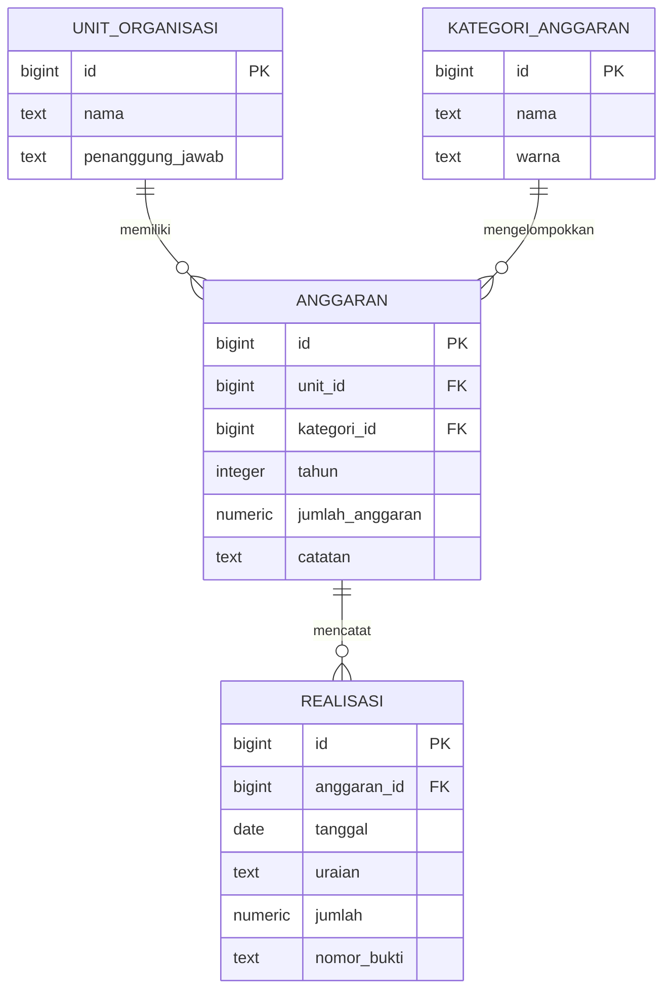

# AKSARA | Akuntabilitas Sistem Anggaran dan Realisasi

Aplikasi AKSARA untuk mengelola anggaran organisasi, Proker per divisi, persetujuan, dan reimburse. Frontend menggunakan HTML, CSS, dan JavaScript yang terhubung langsung ke Supabase; Node.js tidak diperlukan.

## ERD



Satu unit dan satu kategori dapat memiliki banyak alokasi. Setiap alokasi dapat memiliki banyak transaksi realisasi. Kombinasi unit, kategori, dan tahun dibuat unik; realisasi yang melampaui pagu ditolak oleh backend dan trigger database.

## Struktur folder

```text
.
├── backend/
│   ├── .env
│   ├── apps.js
│   └── schema.sql
└── frontend/
    ├── app.js
    ├── index.html
    └── styles.css
```

## Menjalankan Aplikasi

1. Pastikan URL dan publishable key project berada di `frontend/supabase-config.js`.
2. Jika tabel inti belum pernah dibuat, jalankan `backend/schema.sql` satu kali. **Jangan jalankan ulang** pada project yang sudah memiliki data karena script inti berisi seed dan pembersihan data demo lama.
3. Jalankan `backend/workflow_migration.sql` satu kali. Skrip menambah tabel profil, Proker, reimburse, policy akses, dan daftar Proker contoh per divisi tanpa mengubah anggaran/realisasi yang sudah tersimpan.
4. Buka `frontend/index.html` dengan ekstensi Live Server. Dashboard terbuka tanpa halaman login. Form kategori/divisi memakai master Supabase, dengan daftar fallback saat master belum termuat. Setelah workflow migration, pengunjung tanpa login boleh membaca data serta menambah anggaran/realisasi dasar; hapus, kelola Proker, pengajuan reimburse, approval, dan pembayaran menggunakan akun sesuai peran.
5. Untuk menyiapkan admin pertama, daftarkan akun melalui tombol **Masuk**, ganti email placeholder di `backend/bootstrap_admin.sql`, jalankan skrip itu di SQL Editor, lalu masuk sebagai admin.

Jangan jalankan `backend/browser_access.sql` setelah workflow migration karena skrip itu menonaktifkan RLS dan membuka seluruh operasi CRUD anon. Publishable key memang publik; siapa pun dapat menambahkan anggaran/realisasi dasar melalui aplikasi. Gunakan hanya bila memang menerima risiko akses publik. Approval dan pembayaran reimburse tetap hanya diberikan melalui RPC yang memeriksa peran bendahara/admin; pembayaran baru tercatat sebagai realisasi setelah disetujui.

Jika Dashboard tidak tersambung, jalankan workflow migration dan cek pesan pada halaman. Jika login menampilkan `public.profiles` tidak ditemukan, jalankan `backend/repair_profiles.sql` di SQL Editor, lalu masuk ulang. Skrip repair tidak mengubah anggaran/realisasi.